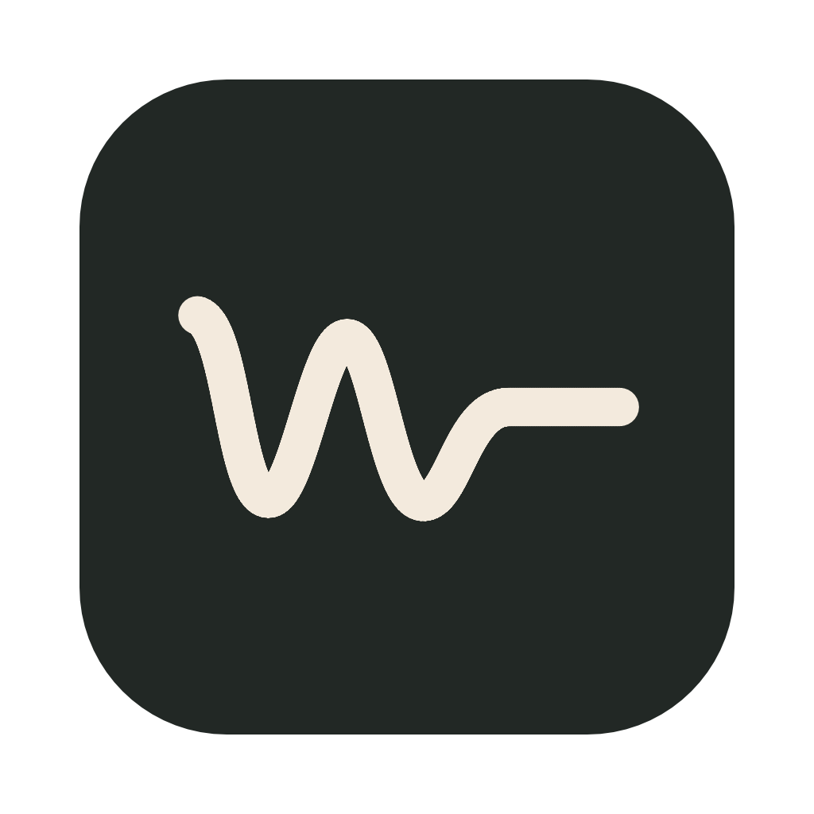
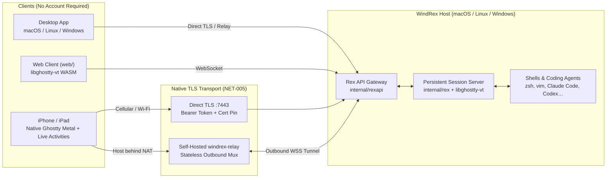

<p align="center">
  
</p>

<h1 align="center">WindRex</h1>

<p align="center">
  <strong>Persistent remote terminal &amp; coding-agent workspace across macOS, iOS, Linux, Windows, and Web.</strong>
</p>

<p align="center">
  English · <a href="README.zh-CN.md">简体中文</a>
</p>

---

**WindRex** keeps your terminal sessions, split layouts, and coding agents running on your Mac or Linux host—so you can start work at your desk, step away, and pick up the exact same session on iPhone, iPad, another desktop, or a browser with low-latency native TLS over cellular networks.

WindRex is an independently developed fork of [GoRex](https://github.com/si-mods/gorex) starting from `v0.56.1`, retaining compatibility with the Rex connection protocol while adding native Direct TLS &amp; self-hosted stateless relay transport ([`NET-005`](docs/NET-005-direct-relay.md)), compact project navigation, and WindRex branding across desktop, iOS, and Web.

## Typical Workflow

1. **Start at your desk**: Open a project on your Mac or remote Linux host with split panes for your shell, editor, logs, and coding agent (Claude Code, Codex, OpenCode, Pi, etc.).
2. **Step away without interrupting anything**: Close the desktop window or lock your laptop—shells and TUIs keep running inside the background session server.
3. **Continue from iPhone or iPad**: Glance at running tasks and agent prompts from **Live Activities** (Dynamic Island / Lock Screen) or tap straight into the live terminal over cellular with sub-second foreground recovery.
4. **Return to desktop seamlessly**: Every pane, directory, scrollback buffer, and split stays in sync across clients.

## Core Features

- **Persistent session server with in-place upgrade** — Shells run inside a background session server (`-server`) backed by headless `libghostty-vt`. Closing the app never kills your processes, full-screen TUIs (`vim`, `lazygit`, `htop`) restore from live snapshots, and `server upgrade` upgrades the server binary in place without dropping shells ([`REF-006`](docs/REF-006-session-server.md)).
- **Direct TLS &amp; Stateless Relay for cellular (`NET-005`)** — Reach your host directly over native TLS 1.3 (with CA certificates or self-signed leaf SHA-256 pinning) or through a self-hosted stateless [`windrex-relay`](cmd/windrex-relay/main.go) binary. No user accounts, no coordination server, and no iOS VPN slot required. Includes 1.5s foreground liveness probes and pipelined ordered writes for responsive typing on high-RTT mobile links ([`NET-005`](docs/NET-005-direct-relay.md)).
- **Mac + iPhone pairing &amp; live host status** — Organize work by **Spaces → Hosts → Projects → Tabs → Split Panes** with compact project sidebars on desktop and iOS, real-time green online indicators for connected hosts, QR code pairing, **Live Activities** (Dynamic Island &amp; Lock Screen), and Home Screen **Widgets** ([`MOD-002`](docs/MOD-002-projects.md), [`IOS-006`](docs/IOS-006-live-activities.md), [`IOS-010`](docs/IOS-010-widgets.md)).
- **Agent-friendly terminal workflows** — Automatic foreground process detection and OSC 7501 status tracking (`working`, `blocked`, `done`, `error`), `gorex skill setup` for Claude Code, Codex, Antigravity CLI, Devin, OpenCode, and Pi, full CLI automation (`ls`, `new`, `split`, `send`, `capture`, `wait`, `run`), pane **Teleport** across hosts ([`DSK-003`](docs/DSK-003-teleport.md)), Ghostty config/theme compatibility, plus local Markdown Note panes.

## Platform Support &amp; Current Status

> **Release status:** WindRex does not have published GitHub Releases or public TestFlight links yet. All clients, the Linux session server, and `windrex-relay` can be built and run from source today.

| Platform | Role | Capabilities | Availability |
|---|---|---|---|
| **macOS** (13.0+) | Desktop client + local host | Persistent tabs/splits, compact project sidebar, Ghostty themes/config, remote hosts, Markdown note panes, Teleport | Build from source (`go tool mygo build` / `dev`) · Signed `.dmg` pending |
| **iOS / iPadOS** | Remote mobile client | Native Ghostty Metal terminal, Direct TLS &amp; Relay over cellular, QR pairing, Live Activities, Widgets, compact project &amp; session lists | Build with Xcode (`ios/GoRex.xcodeproj`) · TestFlight onboarding in progress |
| **Linux** | Headless host + desktop | Persistent session server (`-server`), in-place upgrades, Direct TLS / relay host, shared systemd service, desktop GUI | Build from source (`go build`) · Packages pending |
| **Windows** (10 1809+) | Desktop client + local host | ConPTY session server, custom title bar, remote hosts, Ghostty config | Build from source (`go tool mygo build`) · Installer pending |
| **Web (`web/`)** | Optional local / self-hosted remote client | Multi-host browser terminal powered by `libghostty-vt` WASM, split panes, themes, no local daemon required (no hosted service or PWA shell; see [`DSK-010`](docs/DSK-010-trim-browser-and-web.md)) | Run locally (`npm run dev`) or self-host static `npm run build` |
| **`windrex-relay`** | Stateless reverse-proxy relay | Bridges hosts behind NAT to iOS/remote clients over a single outbound TLS WebSocket with zero stored state | Build from source (`go build ./cmd/windrex-relay`) |

## Interface Preview &amp; Architecture



| Surface | Key UI Elements | Preview Status |
|---|---|---|
| **Desktop (macOS / Linux / Windows)** | Compact project sidebar, green host online dots, split terminal and Markdown note cards, command palette (`⇧⌘P`), light/dark Ghostty themes | WindRex screenshots will be published alongside the first tagged release (captured via the `GOREX_DEBUG` hook with sample data). |
| **iOS / iPadOS** | Compact project &amp; session list, Metal terminal surface, custom key bar, Dynamic Island &amp; Lock Screen Live Activities | WindRex iOS screenshots will be published with the first TestFlight build. |
| **Web (`web/`)** | Multi-host sidebar with live connection dots, split panes, Settings dialog (`npm run dev` in `web/`) | Preview locally via `cd web && npm ci && npm run dev`. |

## Quick Start &amp; Installation

> **Note on CLI naming:** A local binary built with `go build -o build/wind-rex .` can be invoked directly as `./build/wind-rex`. Inside terminals launched by WindRex, the injected shim on `PATH` still uses the inherited `gorex` command name (`docs/REF-001-cli.md`).

### 1. Start a Host (macOS Desktop or Linux Server)

iOS and Web are remote clients—you need at least one running WindRex host (your Mac or a Linux machine).

**macOS / Desktop (from source):**

Requires Go 1.27.4+ (MyGo CLI is pinned in `go.mod`).

```sh
git clone https://github.com/windzu/wind-rex.git
cd wind-rex

# Run the desktop app (rebuilds on change without stealing focus)
go tool mygo dev -background

# Or build a standalone desktop app bundle
go tool mygo build -sign -
```

**Linux Headless Session Server (from source):**

```sh
git clone https://github.com/windzu/wind-rex.git
cd wind-rex
go build -o build/wind-rex .

# Start the persistent session server (use GOREX_DIR to isolate state if desired)
./build/wind-rex -server
```

For systemd installation and multi-client Linux servers, see [`docs/REF-004-shared-server.md`](docs/REF-004-shared-server.md).

> **Upgrading a running server:** Never kill a running server to upgrade it. Run `<new-binary> server upgrade` to replace the server in place while keeping every shell and terminal screen alive.

### 2. Expose the Host for iPhone / iPad Pairing (`NET-005`)

Choose **Option A** if your host is reachable on a public IP or home router port forward, or **Option B** if your host is behind NAT.

#### Option A — Direct TLS (Public IP / Port Forward)

```sh
# Starts a TLS listener on :7443 with a 256-bit Bearer token and self-signed cert
# (or pass --cert FILE --key FILE for a CA-signed certificate), and prints a QR code.
./build/wind-rex rexapi direct on \
  --listen :7443 \
  --public https://203.0.113.10:7443
```

#### Option B — Self-Hosted Stateless Relay (`windrex-relay`, Behind NAT)

1. Build and run `windrex-relay` on any reachable VPS or router:

   ```sh
   go build -o build/windrex-relay ./cmd/windrex-relay
   ./build/windrex-relay \
     -listen :7443 \
     -hosts relay.example.com \
     -secret "replace-with-shared-secret"
   ```

   On startup, `windrex-relay` prints its self-signed TLS certificate SHA-256 pin (omit `-pin` below if using a CA-signed `-cert`/`-key`).

2. Connect your host behind NAT to the relay and display the pairing QR code:

   ```sh
   ./build/wind-rex rexapi direct relay \
     --url https://relay.example.com:7443 \
     --pin "<relay-cert-pin>" \
     --secret "replace-with-shared-secret"
   ```

Useful management commands:

```sh
./build/wind-rex rexapi direct status   # inspect listener / relay connection state
./build/wind-rex rexapi direct qr       # reprint the pairing URL and QR code
./build/wind-rex rexapi direct rotate   # rotate the 256-bit pairing token
./build/wind-rex rexapi direct off      # disable direct / relay access
```

WindRex also retains LAN pairing (`docs/REF-005-rex-api.md`); built-in Tailscale, tailcat, and Hotspot Share were removed across all clients in [`docs/NET-009-remove-tailscale.md`](docs/NET-009-remove-tailscale.md).

### 3. Pair &amp; Connect from iOS, Desktop, or Web

- **iPhone / iPad**: Open **WindRex → Remote Hosts → Add Host**, scan the QR code (or paste the `https://.../#k=<token>&p=<cert_pin>&n=alice-laptop` URL). The Bearer token is stored in Keychain and the certificate pin is verified on every TLS handshake.
- **Desktop to Desktop**: Open **Settings › Remote Hosts → Add Remote Host…** and paste the host's Direct TLS or Relay pairing URL.
- **Web Client**: Start the web app (`cd web && npm ci && npm run dev`), open the local URL in your browser, and add your host gateway URL in **Settings › Hosts** (or pass `?host=<gateway-url>`). Set `WINDREX_WEB_ORIGIN` on the host if deploying the web client to a custom origin.

## Essential Desktop Shortcuts

| macOS | Windows / Linux | Action |
|---|---|---|
| `⌘T` | `Ctrl+Shift+T` | New tab |
| `⌘D` / `⇧⌘D` | `Ctrl+Shift+D` / `Ctrl+Shift+E` | Split right / down |
| `⌘W` / `⇧⌘W` | `Ctrl+Shift+W` | Close pane / tab |
| `⇧⌘↩` | `Ctrl+Shift+Enter` | Zoom focused pane |
| `⌥⌘` + Arrows | `Alt` + Arrows | Move focus across panes |
| `⌃⌘S` | `Ctrl+Shift+S` | Toggle sidebar |
| `⌘J` / `⇧⌘J` | `Ctrl+Shift+J` | Jump to / list panes needing attention |
| `⇧⌘P` | `Ctrl+Shift+P` | Command palette |
| `⌘,` | `Ctrl+,` | Settings (Appearance, Terminal, Theme, Remote, Network) |
| `⌥⌘Q` | — | Quit and end all sessions |

WindRex reads Ghostty configuration (`font-family`, `theme`, `palette`, `cursor-style`, `minimum-contrast`, etc.) with Settings taking precedence (`terminal.minimumContrast` defaults to `3`). See [`docs/DSK-009-terminal-settings.md`](docs/DSK-009-terminal-settings.md).

## Develop locally

- **iOS** needs full Xcode with an iOS Simulator runtime and XcodeGen 2.45.1 or newer. From the repository root run `ios/scripts/build-ghostty-vt.sh`, then run `xcodegen generate` from `ios/`. Open `ios/GoRex.xcodeproj` and run the `GoRex` scheme on an iPhone simulator (the installed app is **WindRex**). A CLI build uses:

  ```sh
  cd ios && xcodebuild -scheme GoRex -destination 'generic/platform=iOS Simulator' CODE_SIGNING_ALLOWED=NO build
  ```

- **Desktop** uses `go tool mygo dev -background` or `go tool mygo build`. For local server-only work, build with `go build -o build/wind-rex .` and run that binary with `-server`. Use an isolated `GOREX_DIR` when testing against a separate data directory.
- **Web** uses `npm ci` and `npm run dev` from `web/`. Run `npm run typecheck` and `npm test` there for local checks.
- **Localization** runs `go tool mygo generate` after editing `locales/*.json` (commit generated `locales/catalog_gen.go` alongside catalog changes).
- **Pre-push verification** runs `go run ./tools/verify` against your diff.

## Distribution

The iOS bundle ID is `wiki.wind.windrex`. Its widget extension is `wiki.wind.windrex.widgets` and shares the App Group `group.wiki.wind.windrex` with the iOS app. Prepare those identifiers and entitlements in the Apple Developer team before setting up the manual TestFlight workflow in `.github/workflows/testflight.yml`.

- **GitHub Actions TestFlight workflow**: Configure repository variables `WINDREX_APPLE_TEAM_ID`, `WINDREX_ASC_APP_ID`, `ASC_KEY_ID`, and `ASC_ISSUER_ID`, plus repository secret `ASC_KEY_P8`.
- **Local signing &amp; upload**: Run `ios/scripts/upload` with `WINDREX_RELEASE_SIGNING=local`, `WINDREX_APPLE_TEAM_ID`, `WINDREX_SIGNING_CERTIFICATE` (SHA-1 of the installed distribution certificate), `WINDREX_APP_PROFILE`, and `WINDREX_WIDGET_PROFILE` (App Store profile UUIDs). Set `BUILD` explicitly or let `asc` query App Store Connect for the next build number. `DESTINATION=export` writes the signed IPA to `ios/build/export`.
- **Publishing to an internal TestFlight group via `asc`**: Also set `WINDREX_ASC_PROFILE`, `WINDREX_ASC_APP_ID`, and `WINDREX_TESTFLIGHT_GROUP_ID`.
- **Optional hosted services**: Set `WINDREX_WEB_ORIGIN` on the host for hosted Web pairing and `WINDREX_PUSH_RELAY_URL` on the host and iOS build for background Live Activity push updates ([`NET-003`](docs/NET-003-push-relay.md)).

## Architecture &amp; Documentation Map

### Repository Entry Points

| Path | Responsibility |
|---|---|
| `main.go` | Desktop app entry point, CLI subcommands, and `-server` mode |
| `ios/GoRex/GoRexApp.swift` | iOS / iPadOS SwiftUI app, Ghostty Metal terminal, Live Activities, and Widgets |
| `cmd/windrex-relay/main.go` | Standalone stateless TLS reverse-proxy relay for hosts behind NAT |
| `internal/rex` | Persistent session server: PTYs, headless `libghostty-vt`, OSC 7501 status, socket protocol |
| `internal/rexapi` | Rex API gateway (revision 12), Direct TLS listener, outbound relay client, LAN/WebTransport admission |
| `internal/directrelay` | Binary WebSocket stream multiplexer (`OPEN`/`DATA`/`CLOSE`/`ACK`), relay server, self-signed cert pinning |
| `web/src/main.ts` | Standalone multi-host Web client (`libghostty-vt` compiled to WASM) |
| `locales/` | English (`en.json`) and Simplified Chinese (`zh-Hans.json`) UI catalogs |

### Key Design &amp; Reference Docs

- **Networking &amp; Remote Access**: [`NET-005-direct-relay.md`](docs/NET-005-direct-relay.md) (Direct TLS &amp; stateless relay) · [`NET-009-remove-tailscale.md`](docs/NET-009-remove-tailscale.md) (Tailscale removal) · [`REF-005-rex-api.md`](docs/REF-005-rex-api.md) (Rex API gateway &amp; pairing) · [`NET-003-push-relay.md`](docs/NET-003-push-relay.md) (Live Activity push relay)
- **Session Server &amp; CLI**: [`REF-006-session-server.md`](docs/REF-006-session-server.md) (headless terminal &amp; recovery) · [`REF-001-cli.md`](docs/REF-001-cli.md) (CLI &amp; agent skill hooks) · [`REF-004-shared-server.md`](docs/REF-004-shared-server.md) (shared Linux systemd server) · [`REF-003-session-size.md`](docs/REF-003-session-size.md) (multi-client sizing)
- **Workspace &amp; Clients**: [`MOD-002-projects.md`](docs/MOD-002-projects.md) (spaces, hosts &amp; projects) · [`MOD-001-osc-7501.md`](docs/MOD-001-osc-7501.md) (program status protocol) · [`DSK-003-teleport.md`](docs/DSK-003-teleport.md) (pane Teleport) · [`DSK-009-terminal-settings.md`](docs/DSK-009-terminal-settings.md) (Ghostty &amp; terminal settings) · [`REF-007-web-client.md`](docs/REF-007-web-client.md) (Web client)
- **iOS Experience &amp; Design**: [`IOS-006-live-activities.md`](docs/IOS-006-live-activities.md) · [`IOS-010-widgets.md`](docs/IOS-010-widgets.md) · [`IOS-012-background-and-network-changes.md`](docs/IOS-012-background-and-network-changes.md) · [`DESIGN.md`](DESIGN.md)

## Upstream Attribution &amp; Credits

WindRex is derived from [GoRex](https://github.com/si-mods/gorex) (`v0.56.1`) and built with [MyGo](https://github.com/si-mods/mygo) and [Ghostty](https://ghostty.org/) (`libghostty-vt`).
Icons: [Lucide](https://lucide.dev) (ISC) and [Simple Icons](https://simpleicons.org) (CC0). Font: [JetBrains Mono](https://www.jetbrains.com/lp/mono/) (OFL).
