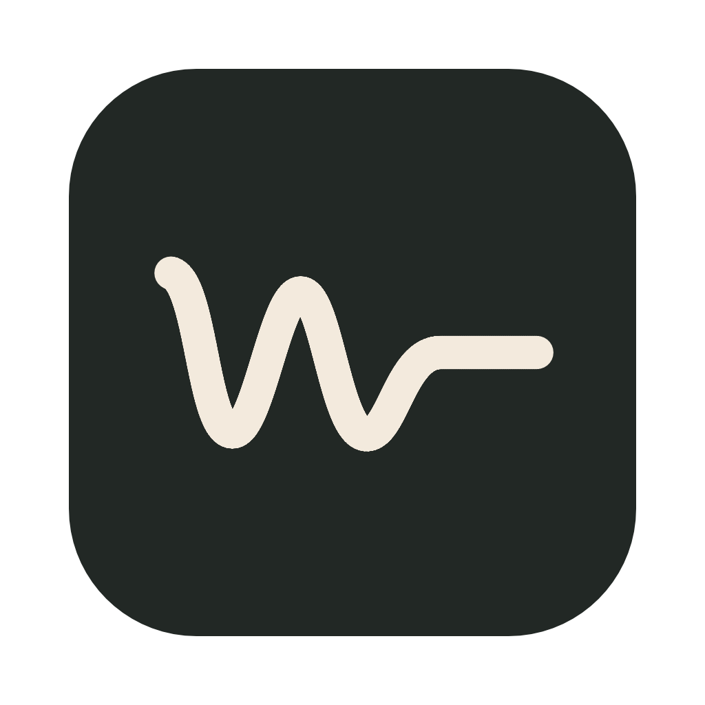
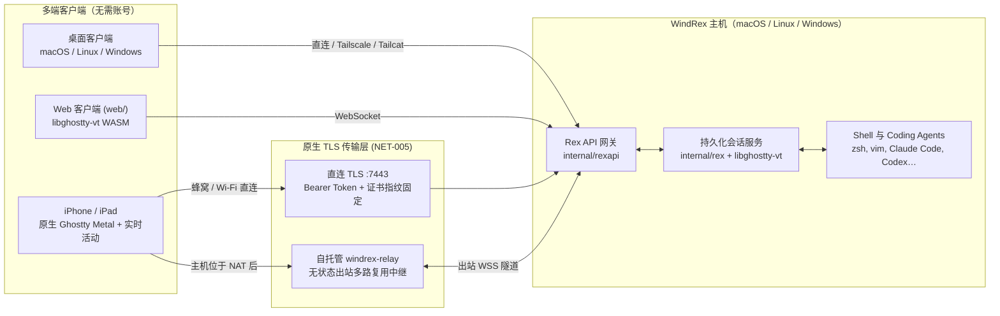

<p align="center">
  
</p>

<h1 align="center">WindRex</h1>

<p align="center">
  <strong>跨 macOS、iOS、Linux、Windows 与 Web 的持久化远程终端与 Coding Agent 工作区。</strong>
</p>

<p align="center">
  <a href="README.md">English</a> · 简体中文
</p>

---

**WindRex** 将你的终端会话、分屏布局与 Coding Agent 持久运行在 Mac 或 Linux 主机上：在电脑前开启开发任务，离开工位后用 iPhone、iPad、另一台桌面设备或浏览器随时接入同一个会话，并在蜂窝网络下通过原生 TLS 获得低延迟的交互与秒级重连体验。

WindRex 基于 [GoRex](https://github.com/si-mods/gorex) `v0.56.1` 独立演进，保留对 Rex 协议的兼容，重点补齐了面向移动蜂窝网络的直连 TLS 与自托管无状态中继传输（[`NET-005`](docs/NET-005-direct-relay.md)）、紧凑项目导航，以及覆盖桌面、iOS 与 Web 的 WindRex 独立品牌体验。

## 典型使用场景

1. **在桌面开启任务**：在 Mac 或远程 Linux 主机上按项目组织终端分屏，运行 Shell、编辑器、构建日志与 Coding Agent（Claude Code、Codex、OpenCode、Pi 等）。
2. **离开电脑，任务不中断**：关闭桌面窗口或锁屏后，所有 Shell 与全屏 TUI 程序继续在后台会话服务中运行。
3. **手机端随时查看与接管**：通过 iOS **实时活动（灵动岛 / 锁屏）** 实时掌握任务进度与待确认提示，点开即可通过蜂窝网络直连恢复同一终端画面并继续输入。
4. **回到桌面无缝衔接**：所有分屏、工作目录、滚动历史与程序状态在各端保持一致。

## 核心特性

- **持久化会话服务与原地热升级** — 所有终端运行在后台会话服务（`-server`）中，由无头 `libghostty-vt` 维护完整屏幕与滚动缓冲。关闭窗口不中断任务，`vim` / `lazygit` / `htop` 等全屏程序重连后精准还原；使用 `server upgrade` 可在不中断任何 Shell 的情况下原地升级服务端（[`REF-006`](docs/REF-006-session-server.md)）。
- **直连 TLS 与无状态中继，专为蜂窝网络优化（`NET-005`）** — iOS 直接走系统原生 `URLSession` WebSocket + TLS 1.3（支持 CA 证书或自签名证书 SHA-256 指纹固定）与 256-bit Bearer Token 鉴权，支持公网/端口映射直连或自托管无状态 [`windrex-relay`](cmd/windrex-relay/main.go) 穿透内网。无需账号系统、不占用 iOS VPN 通道；切回前台 1.5 秒内完成存活探测并快速恢复，支持有序流水线写入以消除高 RTT 下的逐字卡顿（[`NET-005`](docs/NET-005-direct-relay.md)）。
- **Mac + iPhone 配对与主机在线状态** — 通过 **空间 → 主机 → 项目 → 标签页 → 分屏** 统一管理多主机工作区，桌面与 iOS 均提供紧凑项目列表与主机绿色在线状态指示，支持扫码配对、iOS **实时活动（Live Activities）** 及桌面 **小组件（Widgets）**（[`MOD-002`](docs/MOD-002-projects.md)、[`IOS-006`](docs/IOS-006-live-activities.md)、[`IOS-010`](docs/IOS-010-widgets.md)）。
- **面向 Coding Agent 的工作流** — 自动识别前台进程并解析 OSC 7501 状态协议（`working` / `blocked` / `done` / `error`）；支持 `gorex skill setup` 一键为 Claude Code、Codex、Antigravity CLI、Devin、OpenCode、Pi 注入技能与会话钩子；提供完整 CLI 编排命令（`ls` / `new` / `split` / `send` / `capture` / `wait` / `run`）、跨主机窗格 **Teleport**（[`DSK-003`](docs/DSK-003-teleport.md)）、Ghostty 主题配置兼容，以及本地 Markdown 便签窗格。

## 各端能力与当前状态

> **发布状态说明：** 目前仓库尚未发布预构建的 GitHub Releases 二进制包，也尚未开放公开 TestFlight 链接。桌面端、iOS、Linux 服务端、Web 端及 `windrex-relay` 均已支持从源码本地构建与运行。

| 平台 | 角色 | 已支持能力 | 当前获取方式 |
|---|---|---|---|
| **macOS**（13.0+） | 桌面客户端 + 本地 Host | 持久标签与分屏、紧凑项目侧边栏、Ghostty 配置/主题、远程主机、Markdown 便签窗格、Teleport | 从源码构建（`go tool mygo dev` / `build`）· 签名 `.dmg` 待发布 |
| **iOS / iPadOS** | 移动端远程客户端 | 原生 Ghostty Metal 终端、蜂窝直连 TLS &amp; 中继、扫码配对、灵动岛实时活动、小组件、紧凑项目/会话列表 | 使用 Xcode 本地构建（`ios/GoRex.xcodeproj`）· TestFlight 分发接入中 |
| **Linux** | 无头 Host + 桌面端 | 持久会话服务（`-server`）、原地热升级、直连 TLS / 中继接入、systemd 共享服务、桌面 GUI | 从源码构建（`go build`）· 安装包待发布 |
| **Windows**（10 1809+） | 桌面客户端 + 本地 Host | ConPTY 会话服务、自绘标题栏、远程主机、Ghostty 配置 | 从源码构建（`go tool mygo build`）· 安装程序待发布 |
| **Web（`web/`）** | 可选本地 / 自托管远程客户端 | 基于 `libghostty-vt` WASM 的多主机远程终端、分屏、主题设置，无需本地后台（已移除托管部署与 PWA 外壳，见 [`DSK-010`](docs/DSK-010-trim-browser-and-web.md)） | 本地运行（`npm run dev`）或自托管静态构建（`npm run build`） |
| **`windrex-relay`** | 自托管无状态中继服务 | 通过单条主机出站 TLS WebSocket 桥接内网主机与 iOS/远程客户端，不落盘任何凭证 | 从源码构建（`go build ./cmd/windrex-relay`） |

## 界面预览与架构总览



| 客户端 | 核心界面元素 | 预览图状态 |
|---|---|---|
| **桌面端（macOS / Linux / Windows）** | 紧凑项目侧边栏、主机绿色在线状态点、终端与便签分屏卡片、命令面板（`⇧⌘P`）、浅色/深色 Ghostty 主题 | WindRex 真实界面截图（使用脱敏示例数据与 `GOREX_DEBUG` 截图钩子生成）将随首个正式发布版本一并补齐。 |
| **iOS / iPadOS** | 紧凑项目与会话列表、Metal 终端视图、增强快捷键栏、灵动岛与锁屏实时活动 | WindRex iOS 实机/模拟器截图将随首个 TestFlight 构建一并补齐。 |
| **Web（`web/`）** | 带连接状态点的多主机侧边栏、分屏终端、设置面板 | 可直接通过 `cd web && npm ci && npm run dev` 在本地预览。 |

## 快速上手与安装

> **关于命令名说明：** 本地编译产物（如 `build/wind-rex`）可直接以 `./build/wind-rex` 调用；在 WindRex 内部打开的终端里，注入到 `PATH` 的 CLI 垫片仍沿用 `gorex` 命令名（详见 [`docs/REF-001-cli.md`](docs/REF-001-cli.md)）。

### 1. 启动一台主机（macOS 桌面端或 Linux 服务端）

iOS 和 Web 属于远程客户端，使用前需要先启动至少一台 WindRex 主机（你的 Mac 或远程 Linux 机器）。

**macOS / 桌面端（源码构建）：**

需要 Go 1.27.4+（MyGo 工具链已在 `go.mod` 中锁定版本）。

```sh
git clone https://github.com/windzu/wind-rex.git
cd wind-rex

# 开发模式启动（后台运行，代码变更自动重编译且不抢占窗口焦点）
go tool mygo dev -background

# 或构建独立桌面应用包
go tool mygo build -sign -
```

**Linux 无头会话服务（源码构建）：**

```sh
git clone https://github.com/windzu/wind-rex.git
cd wind-rex
go build -o build/wind-rex .

# 启动持久化会话服务（可通过 GOREX_DIR 指定独立数据目录）
./build/wind-rex -server
```

如需配置为 Linux systemd 共享服务，请参阅 [`docs/REF-004-shared-server.md`](docs/REF-004-shared-server.md)。

> **服务端升级提示：** 切勿通过 kill 进程来升级运行中的会话服务。请使用新版本二进制执行 `<new-binary> server upgrade` 原地升级，即可完整保留所有 Shell 进程与屏幕内容。

### 2. 为 iPhone / iPad 开启远程接入与配对（`NET-005`）

如果主机拥有公网 IP 或家用路由器端口映射，推荐使用 **方案 A（直连 TLS）**；如果主机处于多层 NAT 后无法端口映射，推荐使用 **方案 B（自托管无状态中继）**。

#### 方案 A — 直连 TLS（公网 IP / 路由器端口映射）

```sh
# 在 :7443 启动 TLS 监听，自动生成 256-bit Bearer Token 与自签名证书
# （也可通过 --cert 与 --key 指定 CA 签发证书），并打印配对二维码：
./build/wind-rex rexapi direct on \
  --listen :7443 \
  --public https://203.0.113.10:7443
```

#### 方案 B — 自托管无状态中继（`windrex-relay`，内网穿透）

1. 在任意公网可达的 VPS 或路由器上构建并运行 `windrex-relay`：

   ```sh
   go build -o build/windrex-relay ./cmd/windrex-relay
   ./build/windrex-relay \
     -listen :7443 \
     -hosts relay.example.com \
     -secret "replace-with-shared-secret"
   ```

   启动后会输出自签名证书的 SHA-256 指纹（若使用 CA 证书 `-cert`/`-key`，下一步可省略 `--pin`）。

2. 在内网主机上连接中继并打印配对二维码：

   ```sh
   ./build/wind-rex rexapi direct relay \
     --url https://relay.example.com:7443 \
     --pin "<relay-cert-pin>" \
     --secret "replace-with-shared-secret"
   ```

常用管理命令：

```sh
./build/wind-rex rexapi direct status   # 查看直连 / 中继连接状态
./build/wind-rex rexapi direct qr       # 重新打印配对 URL 与二维码
./build/wind-rex rexapi direct rotate   # 轮换 256-bit 配对 Token
./build/wind-rex rexapi direct off      # 关闭直连 / 中继接入
```

此外，WindRex 同样保留了局域网配对（详见 [`docs/REF-005-rex-api.md`](docs/REF-005-rex-api.md)）；iOS 内置 Tailscale、Tailcat 与个人热点共享已按 [`docs/NET-009-remove-tailscale.md`](docs/NET-009-remove-tailscale.md) 移除。

### 3. 在 iOS、桌面或 Web 端完成连接

- **iPhone / iPad**：打开 **WindRex → 远程主机 → 添加主机**，扫描主机打印的二维码（或粘贴 `https://.../#k=<token>&p=<cert_pin>&n=alice-laptop` 链接）。Bearer Token 会保存在系统 Keychain 中，每次 TLS 握手均校验固定证书指纹。
- **桌面连远程主机**：打开 **设置 › 远程主机 → 添加远程主机…**，或在 **设置 › 服务器** 中启用 Tailscale 发现。
- **Web 端**：在 `web/` 下运行 `npm ci && npm run dev`，在浏览器中打开本地地址并在 **设置 › 主机** 中添加主机网关地址（或通过 `?host=<gateway-url>` 快速连接）。如需独立部署 Web 端，请在主机上配置 `WINDREX_WEB_ORIGIN`。

## 常用桌面快捷键

| macOS | Windows / Linux | 功能 |
|---|---|---|
| `⌘T` | `Ctrl+Shift+T` | 新建标签页 |
| `⌘D` / `⇧⌘D` | `Ctrl+Shift+D` / `Ctrl+Shift+E` | 向右 / 向下分屏 |
| `⌘W` / `⇧⌘W` | `Ctrl+Shift+W` | 关闭窗格 / 标签页 |
| `⇧⌘↩` | `Ctrl+Shift+Enter` | 缩放当前窗格 |
| `⌥⌘` + 方向键 | `Alt` + 方向键 | 切换焦点窗格 |
| `⌃⌘S` | `Ctrl+Shift+S` | 显示/隐藏侧边栏 |
| `⌘J` / `⇧⌘J` | `Ctrl+Shift+J` | 跳转到/列出需要处理的窗格 |
| `⇧⌘P` | `Ctrl+Shift+P` | 打开命令面板 |
| `⌘,` | `Ctrl+,` | 打开设置（外观、终端、主题、远程、网络） |
| `⌥⌘Q` | — | 退出并结束所有会话 |

WindRex 自动兼容 Ghostty 配置文件（字体、主题、调色板、光标样式、`minimum-contrast` 等），且应用内设置优先于配置文件（`terminal.minimumContrast` 默认为 `3`）。详见 [`docs/DSK-009-terminal-settings.md`](docs/DSK-009-terminal-settings.md)。

## 本地开发与分发

- **iOS 本地构建**：需要完整版 Xcode（含 iOS Simulator 运行时）与 XcodeGen 2.45.1+。在仓库根目录执行 `ios/scripts/build-ghostty-vt.sh`，随后在 `ios/` 下执行 `xcodegen generate`，在 `ios/GoRex.xcodeproj` 中使用 `GoRex` scheme 运行（安装后的应用名为 **WindRex**）。
- **桌面端本地开发**：使用 `go tool mygo dev -background` 或 `go tool mygo build`；纯服务端开发可用 `go build -o build/wind-rex .` 后运行 `-server`。
- **Web 端本地开发**：在 `web/` 目录执行 `npm ci && npm run dev`，使用 `npm run typecheck` 和 `npm test` 运行本地检查。
- **TestFlight 签名与分发配置**：Bundle ID（`wiki.wind.windrex`）、Widget Extension（`wiki.wind.windrex.widgets`）、App Group（`group.wiki.wind.windrex`）以及 GitHub Actions / 本地 `ios/scripts/upload` 签名环境变量说明详见 [README.md#distribution](README.md#distribution)。
- **提交前校验**：运行 `go run ./tools/verify` 执行与当前 diff 匹配的检查。

## 架构与文档索引

### 代码入口

| 路径 | 职责 |
|---|---|
| `main.go` | 桌面应用入口、CLI 子命令与 `-server` 服务端模式 |
| `ios/GoRex/GoRexApp.swift` | iOS / iPadOS SwiftUI 应用、Ghostty Metal 终端、实时活动与小组件 |
| `cmd/windrex-relay/main.go` | 面向 NAT 主机的独立无状态 TLS 反向代理中继 |
| `internal/rex` | 持久化会话服务：PTY、无头 `libghostty-vt`、OSC 7501 状态解析、Unix Socket 协议 |
| `internal/rexapi` | Rex API 网关（revision 12）、直连 TLS 监听、出站中继客户端与多传输接入控制 |
| `internal/directrelay` | 二进制 WebSocket 流多路复用器（`OPEN`/`DATA`/`CLOSE`/`ACK`）、中继服务与自签名证书固定 |
| `web/src/main.ts` | 独立多主机 Web 客户端（基于编译为 WASM 的 `libghostty-vt`） |
| `locales/` | 英文（`en.json`）与简体中文（`zh-Hans.json`）界面文案 |

### 设计与参考文档

- **网络与远程接入**：[`NET-005-direct-relay.md`](docs/NET-005-direct-relay.md)（直连 TLS 与无状态中继）· [`NET-009-remove-tailscale.md`](docs/NET-009-remove-tailscale.md)（移除内置 Tailscale）· [`REF-005-rex-api.md`](docs/REF-005-rex-api.md)（Rex API 网关与配对）· [`NET-003-push-relay.md`](docs/NET-003-push-relay.md)（实时活动推送中继）
- **会话服务与 CLI**：[`REF-006-session-server.md`](docs/REF-006-session-server.md)（无头终端与恢复机制）· [`REF-001-cli.md`](docs/REF-001-cli.md)（CLI 与 Agent 技能钩子）· [`REF-004-shared-server.md`](docs/REF-004-shared-server.md)（Linux systemd 共享服务）· [`REF-003-session-size.md`](docs/REF-003-session-size.md)（多端窗口尺寸协商）
- **工作区与客户端**：[`MOD-002-projects.md`](docs/MOD-002-projects.md)（空间、主机与项目）· [`MOD-001-osc-7501.md`](docs/MOD-001-osc-7501.md)（程序状态协议）· [`DSK-003-teleport.md`](docs/DSK-003-teleport.md)（跨主机 Teleport）· [`DSK-009-terminal-settings.md`](docs/DSK-009-terminal-settings.md)（Ghostty 与终端设置）· [`REF-007-web-client.md`](docs/REF-007-web-client.md)（Web 客户端）
- **iOS 体验与界面规范**：[`IOS-006-live-activities.md`](docs/IOS-006-live-activities.md) · [`IOS-010-widgets.md`](docs/IOS-010-widgets.md) · [`IOS-012-background-and-network-changes.md`](docs/IOS-012-background-and-network-changes.md) · [`DESIGN.md`](DESIGN.md)

## 上游致谢

WindRex 衍生自 [GoRex](https://github.com/si-mods/gorex)（`v0.56.1`），基于 [MyGo](https://github.com/si-mods/mygo) 与 [Ghostty](https://ghostty.org/)（`libghostty-vt`）构建。
图标来自 [Lucide](https://lucide.dev)（ISC）与 [Simple Icons](https://simpleicons.org)（CC0）；内置字体为 [JetBrains Mono](https://www.jetbrains.com/lp/mono/)（OFL）。
